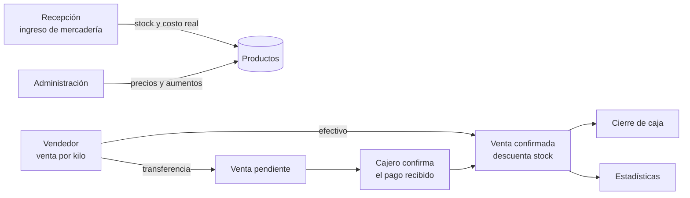

# Gancho — Punto de venta para carnicerías


> **MVP de punto de venta para un comercio que vende por peso.** Separa el trabajo por rol (vendedor, cajero, recepción de mercadería y administración), registra ventas por kilo, controla el stock estimado y hace un **cierre de caja** que detecta diferencias de efectivo.

*English summary: an MVP point-of-sale PWA for a butcher shop. React 19 + Tailwind front end with a touch keypad, Express 5 + MySQL API. Role-based screens (seller, cashier, goods receiving, admin), weight-based sales with transactional stock updates, cashier confirmation for bank transfers, cash-count closing with server-side difference calculation, goods intake with waste percentage and real cost per kg, bulk price increases and a 30-day sales chart. Docker images are built and published to GHCR by GitHub Actions.*

---

## Flujo de trabajo



| Rol | Pantalla | Qué hace |
|---|---|---|
| **Vendedor** | Punto de venta | Elige cortes del catálogo, ingresa los kilos con un teclado numérico táctil y cobra en efectivo o transferencia. |
| **Cajero** | Confirmaciones | Ve las ventas por transferencia pendientes y las confirma cuando el pago entra; recién ahí se descuenta el stock. |
| **Cajero** | Cierre de caja | Ingresa el efectivo contado; el servidor lo compara con las ventas en efectivo confirmadas del día y guarda la diferencia. |
| **Recepción** | Ingreso de mercadería | Carga unidades, peso bruto, costo por kilo y % de desperdicio; devuelve peso neto, inversión, **costo real por kilo** y la venta proyectada. |
| **Administración** | Precios | ABM del catálogo, **aumento masivo por categoría** (%) y gráfico de ventas de los últimos 30 días. |

## Decisiones técnicas

- **Ventas transaccionales** — la venta, su detalle y el descuento de stock se escriben dentro de una transacción de MySQL con *rollback* ante cualquier error.
- **Cierre de caja calculado en el servidor** — el cliente sólo envía el monto contado; el total esperado y la diferencia se calculan y guardan en el backend, así el registro no depende de lo que muestre la pantalla.
- **Costo real** — el costo por kilo se calcula sobre el peso neto (descontando la merma), que es lo que realmente se puede vender.
- **Autoinicialización** — si la base está vacía, el backend carga `schema.sql` al arrancar.
- **Imágenes publicadas por CI** — GitHub Actions construye las imágenes de backend y frontend y las publica en GitHub Container Registry; el servidor sólo hace `docker compose pull && up`.
- **PWA** instalable en la tablet o el celular del mostrador.

## Stack

| Capa | Tecnologías |
|---|---|
| Frontend | React 19, Vite, Tailwind CSS 4, React Router 7, Recharts, Lucide, vite-plugin-pwa |
| Backend | Node.js, Express 5, mysql2 |
| Base de datos | MySQL 8 |
| Infraestructura | Docker, Nginx (sirve el frontend y hace de proxy a `/api`), GitHub Actions → GHCR |

## Levantar el proyecto

### Desarrollo

Requisitos: Node.js 20+ y MySQL 8.

```bash
git clone https://github.com/SoyMonardez/gancho-app.git
cd gancho-app

# Backend (http://localhost:5000)
cd backend
npm install
# crear backend/.env con DB_HOST, DB_USER, DB_PASSWORD y DB_NAME=genesis_meat
npm run dev

# Frontend (otra terminal, http://localhost:5173; /api va al backend)
cd frontend
npm install
npm run dev
```

### Producción con Docker

```bash
cp .env.example .env     # DB_ROOT_PASSWORD, DB_USER, DB_PASSWORD
docker compose pull
docker compose up -d
```

El `docker-compose.yml` usa las imágenes publicadas en GHCR y se conecta a una red `nginx_network` externa (pensado para un VPS con Nginx Proxy Manager).

## API

| Método y ruta | Qué hace |
|---|---|
| `GET /api/productos` · `POST` · `PUT /:id` · `DELETE /:id` | Catálogo de productos |
| `PUT /api/productos/aumento-masivo` | Aumento porcentual por categoría |
| `POST /api/ventas` | Registra una venta (transaccional) |
| `GET /api/ventas/pendientes` · `PUT /api/ventas/:id/confirmar` | Transferencias a confirmar |
| `GET /api/ventas/historial` · `POST /api/ventas/archivar-dia` | Historial y archivo diario |
| `POST /api/caja/cierre-ciego` · `GET /api/caja/resumen-dia` | Cierre de caja y resumen |
| `POST /api/mercaderia` · `GET /api/mercaderia` | Ingresos de mercadería |
| `GET /api/estadisticas/grafica` | Ventas de los últimos 30 días |

## Estado y próximos pasos

Es un **MVP** construido para validar el flujo con un comercio real. Lo siguiente en la lista:

- Autenticación por rol (hoy el rol se elige en la pantalla inicial).
- Cierre totalmente ciego: ocultar el resumen del día hasta que el cajero registre el monto contado.
- Usar siempre rutas relativas a `/api` (una pantalla de administración todavía apunta a `localhost`).
- Pruebas automatizadas de ventas, stock y cierre de caja.

## Autor

**Alejo Monárdez** — relevamiento del flujo con el comercio, frontend, backend, base de datos y pipeline de despliegue.

[Portfolio](https://alejomonardez.com) · [LinkedIn](https://www.linkedin.com/in/alejo-monardez/) · [GitHub](https://github.com/SoyMonardez)
